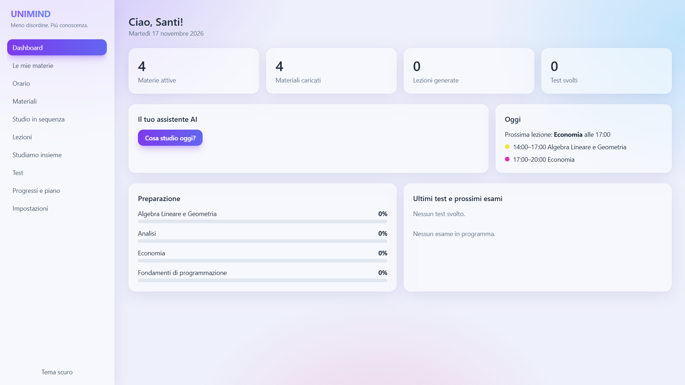
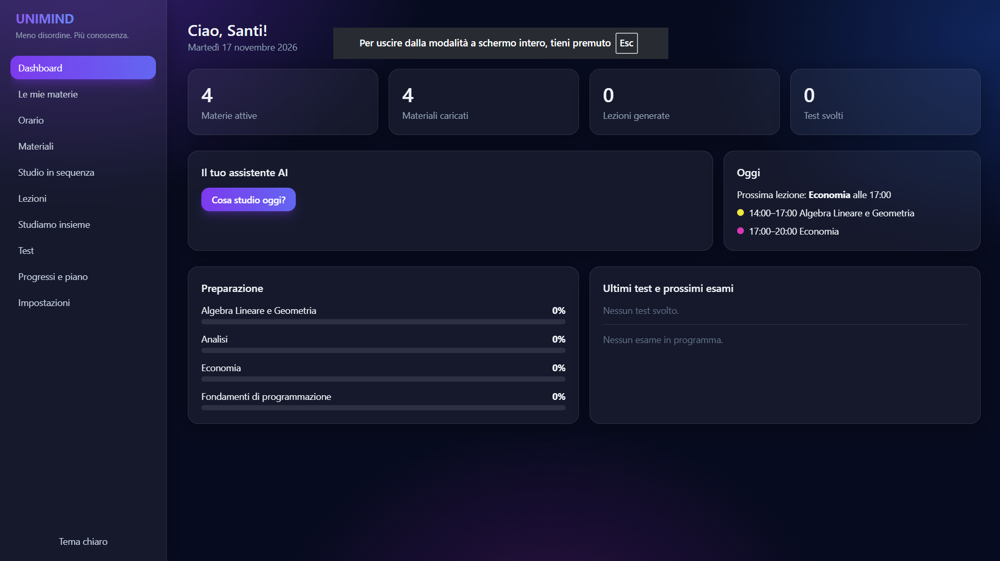
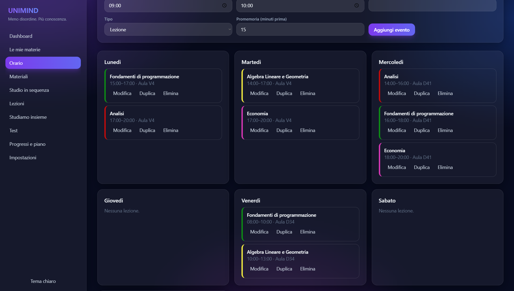
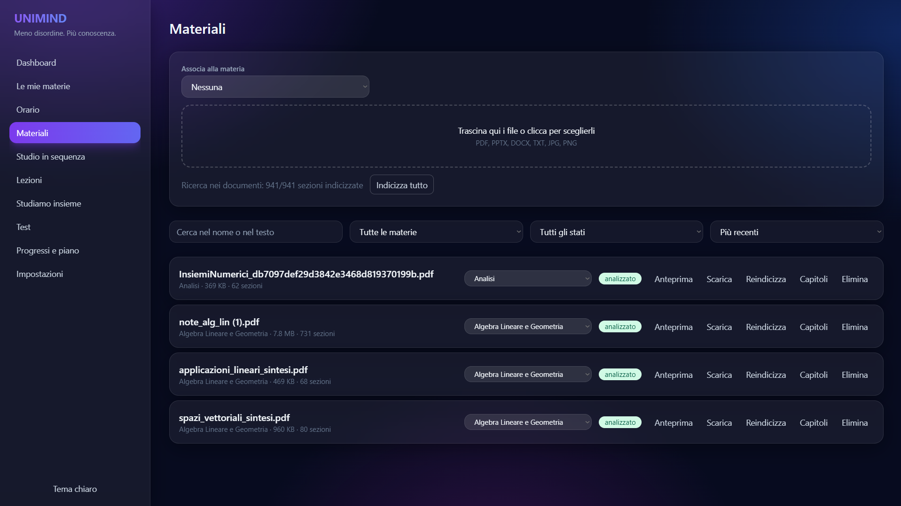
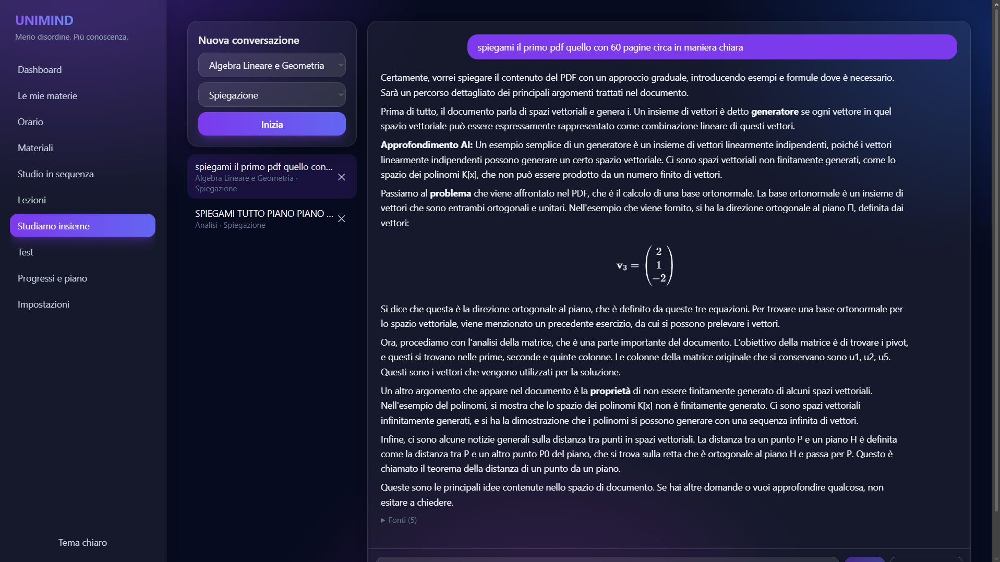
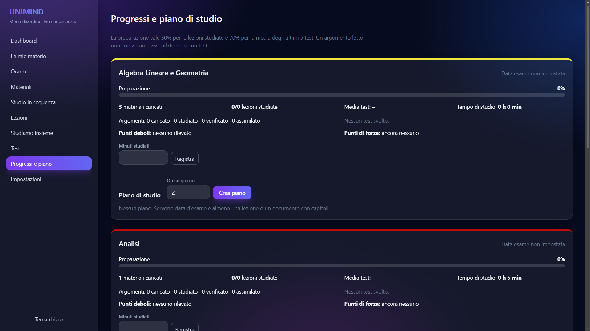

# UniMind

**A private, local AI study assistant. Upload your notes, get lessons, a tutor that cites your own documents, tests, and a study plan — all running on your computer with [Ollama](https://ollama.com).**

> *Less clutter. More knowledge. Your future, one exam at a time.*

**Status: 1.0 beta.** Built and tested by hand; see [Known limitations](#known-limitations) and [TESTS.md](TESTS.md).
**Language: the interface and the AI prompts are currently in Italian.** The README is in English. Translations are very welcome — see [CONTRIBUTING.md](CONTRIBUTING.md).

<!-- Add screenshots here, e.g. docs/screenshots/dashboard.png -->

---

## Why UniMind?

- **100% local.** Your documents, conversations and results never leave your machine. No cloud AI APIs, no telemetry, no accounts.
- **Works with your material.** The tutor answers from *your* PDFs, slides and notes and shows its sources (file, page, chapter). If your documents don't contain the answer, it says so.
- **Built for studying, not just chatting.** Lessons, tests, progress tracking and exam planning in one place.

## Features

| Area | What it does |
|---|---|
| **Subjects & timetable** | Subjects with colors and exam dates; weekly timetable with browser reminders |
| **Materials** | Upload PDF, PPTX, DOCX, TXT (and JPG/PNG with optional OCR); text extraction, search, preview |
| **Local RAG** | Chunking → local embeddings (Ollama) → ChromaDB on disk → semantic search |
| **Study in sequence** | Split a document into chapters with the AI, generate one lesson per chapter, study them in order |
| **Lessons** | University-style lessons from your material, editable, with personal notes and read-aloud (browser speech) |
| **AI tutor** | Explanation, quiz-me and exercise modes; a "I didn't understand" button restarts from the basics; sources cited |
| **Tests** | Multiple choice, true/false, open, fill-in, exercises, programming, logic; AI grading with explicit criteria; indicative grade out of 30 |
| **Progress & study plan** | Preparation per subject; day-by-day plan up to your exam, re-plannable when you fall behind |
| **Math** | Formulas written by the AI in LaTeX and rendered with KaTeX (offline) |
| **Backup** | Daily automatic backup, manual backup, restore, export to JSON + Markdown |

# 📸 UNIMIND – Application Preview

Scopri l'interfaccia di UNIMIND e le sue principali funzionalità.

## 🏠 Dashboard

La schermata principale di UNIMIND, disponibile in modalità chiara e scura.

<table>
  <tr>
    <td align="center"><strong>☀️ Light Mode</strong></td>
    <td align="center"><strong>🌙 Dark Mode</strong></td>
  </tr>
  <tr>
    <td></td>
    <td></td>
  </tr>
</table>

## 📚 Gestione delle materie

Organizza le tue materie e mantieni tutto il materiale di studio in ordine.

<p align="center">
  
</p>

## 📄 Gestione dei documenti

Carica e organizza i PDF delle tue dispense per utilizzarli durante lo studio.

<p align="center">
  
</p>

## 🤖 Tutor AI

Interagisci con l'intelligenza artificiale per comprendere meglio gli argomenti e ricevere supporto personalizzato.

<p align="center">
  
</p>

## 📈 Monitoraggio dei progressi

Tieni sotto controllo il tuo percorso di apprendimento e monitora i tuoi progressi.

<p align="center">
  
</p>

## How it works

```
 Browser (React + Tailwind)  ──►  FastAPI backend (127.0.0.1:8000)  ──►  Ollama (localhost:11434)
        localhost:3000                  │   SQLite  +  ChromaDB                (LLM + embeddings)
                                        └── storage/ (your files on disk)
```

Only the backend talks to Ollama, and it only listens on `127.0.0.1`. Nothing is exposed to the network.

## Requirements

| Software | Version | Notes |
|---|---|---|
| **Ollama** | recent | https://ollama.com |
| **Python** | 3.10 – 3.12 recommended | Very new Python versions may not have ChromaDB wheels yet |
| **Node.js** | 18+ (LTS) | https://nodejs.org |
| **RAM** | 8 GB minimum | More RAM = bigger, better models |

## 1. Install Ollama and download models

1. Install Ollama from https://ollama.com and make sure it is running (`http://localhost:11434` should say *"Ollama is running"*).
2. UniMind needs **two models**: a *chat model* (writes lessons, answers, tests) and an *embedding model* (powers search in your documents).

```bash
# embedding model (small, required for document search)
ollama pull nomic-embed-text

# chat model — pick one that fits your RAM (see table)
ollama pull qwen2.5:3b
```

### Which chat model should I use?

Bigger models write better lessons, follow formats more reliably and make fewer mistakes with formulas — but need more memory and are slower. You can switch models at any time in **Settings**.

| Free RAM | Suggested chat model | Notes |
|---|---|---|
| ~8 GB | `qwen2.5:3b` | Fast. OK for chat; tests/plans/chapters may occasionally fail and need a retry |
| ~16 GB | `qwen2.5:7b` | Good balance for lessons and tests |
| 24 GB+ | `qwen2.5:14b` or a larger model | Best quality |

Other model families (Llama, Gemma, …) also work — see https://ollama.com/library. Do **not** select a chat model in the *embedding* field: embeddings need an embedding model such as `nomic-embed-text`. If you change the embedding model later, re-index your documents.

## 2. Install and run UniMind

> ⚠️ **Windows users:** do **not** put the folder inside OneDrive/Dropbox/Google Drive (e.g. Desktop or Documents). Sync clients lock files and break `npm install`. Use something like `C:\UNIMIND`.

```bash
git clone https://github.com/YOUR_USERNAME/unimind.git
cd unimind
```

- **Windows:** double-click **`start_unimind.bat`**
- **macOS / Linux:** `./start_unimind.sh`

The script checks Python/Node/Ollama, installs dependencies (first run takes a few minutes), starts the backend and the frontend, and opens **http://localhost:3000**. Keep the two terminal windows open while you use the app. The script never installs system software for you.

Manual start (any OS):

```bash
# terminal 1 — backend
cd backend
python -m venv .venv
.venv/bin/pip install -r requirements.txt        # Windows: .venv\Scripts\pip ...
.venv/bin/python -m uvicorn app.main:app --host 127.0.0.1 --port 8000

# terminal 2 — frontend
cd frontend
npm install
npm run dev -- --port 3000
```

## 3. Connect Ollama (first run)

1. Open **Settings**. The dot next to "Ollama" should be green.
2. Choose the **chat model** and the **embedding model** (`nomic-embed-text`), then **Save**.
3. Press **Test connection** — the model should answer.

## 4. Typical workflow

1. **My subjects** → create a subject (set the exam date if you want a study plan).
2. **Materials** → upload your notes, assign the subject, then press **Index all**.
3. **Study in sequence** → pick a document → *Recognize chapters* → *Generate all missing lessons* → read and mark lessons as studied.
4. **Study together** → ask the tutor questions about your material; use quiz mode to be examined.
5. **Test** → generate a test, take it, see your score, level and topics to review.
6. **Progress & plan** → see your preparation and generate a day-by-day plan to the exam.

Preparation is computed transparently: **30%** studied lessons + **70%** average of your last 5 tests. A topic that was only read is never counted as mastered — you need a test.

## Backup & your data

Everything is stored in the project folder:

| Folder | Content |
|---|---|
| `database/` | SQLite database |
| `storage/` | Your uploaded files |
| `vectorstore/` | Search index (can be rebuilt) |
| `backups/` | Backups |
| `logs/` | Local logs |

A backup is created automatically once a day (the last 7 are kept). Use **Settings → Backup and data** to create, download, restore or export. After a restore, press **Index all** again to rebuild the search index. These folders are in `.gitignore`, so your notes are never committed by accident.

## Privacy

- No cloud AI, no analytics, no telemetry (ChromaDB telemetry is disabled).
- The backend listens only on `127.0.0.1`; Ollama is only reached by the backend.
- After the initial setup (installing dependencies and downloading models) UniMind works **offline**.
- *Not yet verified by automated tests: run the offline check in [TESTS.md](TESTS.md) on your machine.*

## Troubleshooting

| Problem | Cause / fix |
|---|---|
| `ERR_CONNECTION_REFUSED` on localhost:3000 | The frontend is not running. Keep the "UniMind Frontend" window open; check `node -v` |
| `npm install` fails with `EPERM` / `EFTYPE` | The folder is inside OneDrive (or antivirus blocks `esbuild`). Move it to `C:\UNIMIND` and run `npm install` again |
| "Ollama is not reachable" | Start Ollama (`ollama serve` or the app) |
| Error **501 Not Implemented** while indexing | The selected *embedding model* is not an embedding model. Choose `nomic-embed-text` |
| Error **500** from Ollama / "requires more memory" | The chat model is too big for your free RAM. Choose a smaller one and close other programs |
| "The model did not produce valid …" | Small models sometimes break the required format. Retry or use a larger model |
| Tutor says it found no documents | Documents are not indexed, or belong to a different subject. Press **Index all** and check the subject of the document |
| Diagnose indexing | Open http://127.0.0.1:8000/api/rag/diagnostics |

## Known limitations

- **UI and AI prompts are in Italian** (translations welcome).
- **Math in PDFs:** formulas are extracted as text and often come out garbled; the AI reconstructs them and can make mistakes. Always check important formulas against your original. Scanned or handwritten notes have no text to extract without OCR.
- **OCR is optional** and needs extra software (Tesseract). Without it, scanned PDFs and images end in an error state with an explanation.
- **Old `.doc` / `.ppt`** files are not supported — save them as `.docx` / `.pptx`.
- **Quality depends on your model.** Small models are fast but make more mistakes; one lesson uses up to ~12,000 characters of a chapter.
- Single local user: no multi-user accounts yet.
- The indicative grade out of 30 is just *percentage × 30*, not an official grade.

## Project structure

```
backend/app/     FastAPI app: ai_service (Ollama), rag, documents, lessons, study, quizzes, plans, progress, backup, ...
frontend/src/    React + TypeScript + Tailwind interface
database/ storage/ vectorstore/ backups/ logs/   your local data (git-ignored)
```

Interactive API documentation: http://127.0.0.1:8000/docs (while the backend is running).

## Tech stack

React · TypeScript · Tailwind CSS · KaTeX · FastAPI · SQLite · ChromaDB · PyMuPDF · python-pptx · python-docx · Ollama

## Roadmap

- Configurable language (interface + prompts)
- Automated tests
- Local OCR including math
- Multi-user mode (with Ollama never exposed to the internet)

## Contributing

See [CONTRIBUTING.md](CONTRIBUTING.md). Bug reports with the output of `/api/rag/diagnostics` (if relevant) and the last lines of `logs/unimind.log` are very helpful.

## License

[MIT](LICENSE) — free to use, modify and share. UniMind is an educational tool: AI output can be wrong, so verify important content against your course material.

---

Made by **[Your name]** — feel free to open an issue or say hi.
